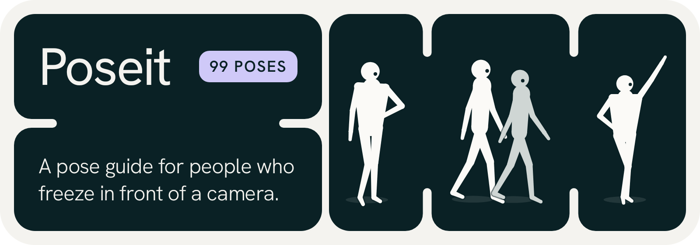
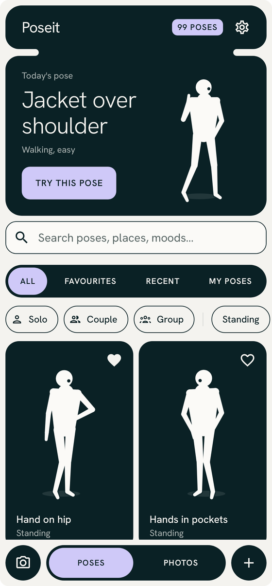
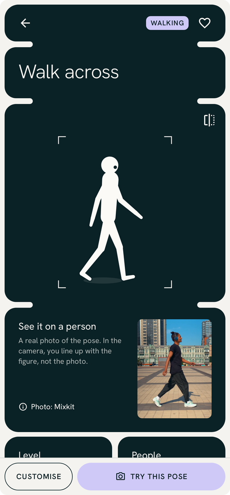
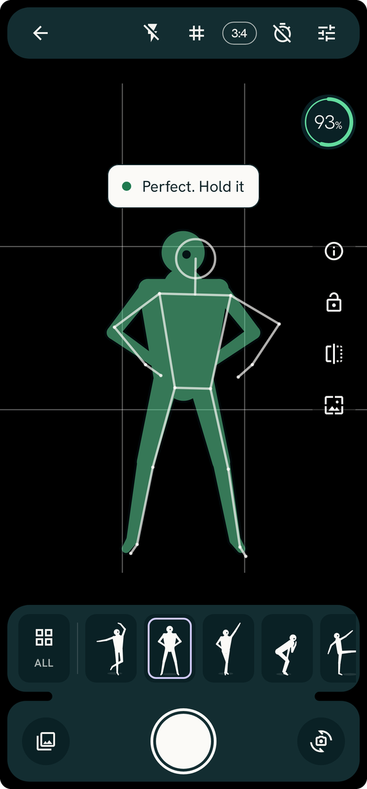
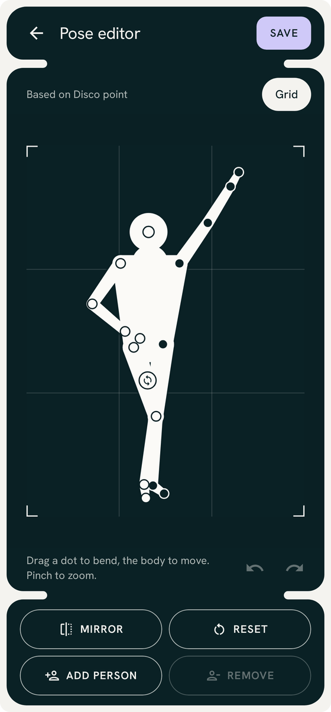
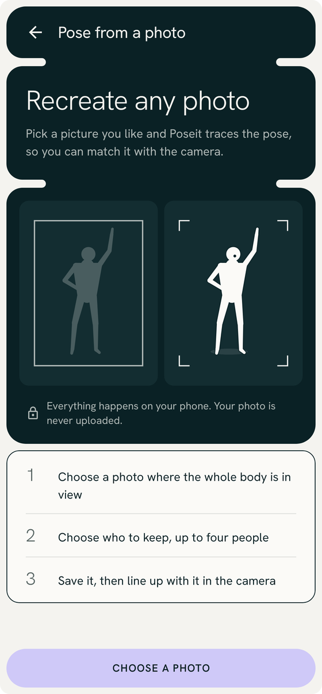
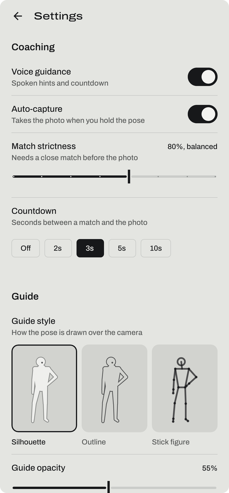
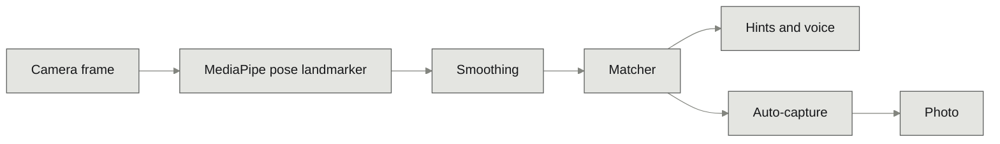

<p>
  <picture>
    <source media="(prefers-color-scheme: dark)" srcset="docs/images/banner-dark.png">
    
  </picture>
</p>

Poseit is a free pose-guide camera for Android. Pick one of 99 poses and line yourself up with the figure
drawn over the camera. Poseit tells you what to change, out loud and on screen, and takes the photo when you
hold the pose. Everything runs on your phone and works offline, with no account, ads or subscription.

[](https://github.com/mdhaarishussain/Poseit/releases/latest)
[](https://github.com/mdhaarishussain/Poseit/actions/workflows/android.yml)
[](#download)

## Download

<a href="https://github.com/mdhaarishussain/Poseit/releases/latest"></a>

**[Download the latest APK](https://github.com/mdhaarishussain/Poseit/releases/latest)** from the newest
release, where it's listed under Assets. On a computer, scan the code with your phone to open the release
there. The current version is 1.1.0 ([release notes](docs/releases/v1.1.0.md)) and the file is
`Poseit-v1.1.0.apk`. Poseit needs Android 7.0 or newer and runs best on a recent phone.

To install, open the APK on your phone. The first time, Android asks you to allow your browser or file manager
to install unknown apps: allow it, then tap Install.

To update, install the new APK over the old one. Your poses, favourites and settings stay, because every
release is signed with the same key.

Poseit hasn't been tried on a physical phone yet. [Status](#status) lists what has been tested and what is
known not to work.

## Screenshots

<p>
  
  
  <br>
  
  
  
</p>

## Features

### Pick a pose

- 99 original poses in 11 categories, from standing, sitting and walking to selfies, couples and groups.
- Filter by the number of people, category, place and mood, or search for words like "beach" or "confident".
- Each pose has a short description and numbered steps, and the library suggests one pose to try each day.
- Keep favourites; recently used poses get their own tab.

### Line up

- The pose is drawn over the live camera as a silhouette, an outline or a stick figure. Move, resize, rotate
  and mirror it, change its opacity, or lock it in place.
- MediaPipe finds your body and Poseit scores the match from 0 to 100, colouring each limb from red to green
  as it lines up.
- Short hints, on screen and spoken, say what to change: "Raise your left arm", "Step back", "Your face is in
  shadow. Turn toward the light". With the back camera they're written for the person taking the photo: "Ask
  them to raise their left arm", "Move the phone left".
- A grid (rule of thirds, golden ratio or centre cross), a level, and 3:4, 9:16 or 1:1 framing. Lock the
  background to keep a faded copy of your framing on screen, so a helper can match it.

### Get the shot

- Auto-capture takes the photo when you hold the pose, after a countdown you choose: off, 2, 3, 5 or 10
  seconds.
- A self-timer of 3, 5 or 10 seconds, which you can also start by raising a hand above your head.
- Photoshoot mode takes 3, 5, 10 or unlimited shots, 2 to 10 seconds apart.
- The volume buttons work as a shutter. Photos are saved at full resolution in Pictures/Poseit, and you can
  look through them in Your photos.

### Make your own

- Customise any pose or draw one from scratch: drag the mannequin's joints, mirror it, and add up to four
  people.
- Pose from a photo: pick a picture and Poseit traces the pose on your phone. In the camera, line up with the
  traced figure or with a faded copy of the photo.
- Export your poses to a file and import them on another phone.

### Compared with paid pose apps

Poseit brings together ideas that are spread across paid apps: a pose library with a see-through overlay and
your own photo as a reference (Poseful), outlines for up to four people and background matching (SOVS2), a
hands-free timer, interval shooting and a spoken countdown (Lens Buddy), and coaching for both the subject and
the photographer, with lighting and framing checks (SuperPose). On top of those it matches your pose live,
takes the photo by itself and lets you edit poses. Poseit isn't affiliated with any of these apps.

## Privacy

Poseit needs no account and no network connection. The camera feed, your photos and your poses stay on your
phone. The one exception is MediaPipe's built-in usage logging: the library adds the internet permission and
may send anonymous usage statistics to Google while you're online.

## Status

Poseit 1.1.0 hasn't been tried on a physical phone yet. Its 273 automated tests all pass on the JVM:

- engine tests, including a check that every built-in pose can actually be matched;
- Robolectric UI-flow tests on Android 7.0, 9 and 15 (onboarding, library, detail, editor, settings, gallery,
  pose from a photo, camera permission and controls);
- screenshot tests, including small phones and large fonts.

Three independent review rounds fixed 50 issues. What the tests can't reach still needs a check on a phone:
live CameraX and MediaPipe detection, voice (TextToSpeech), saving to the gallery, and how well real
detections score. If you try it on a phone, please
[report what you see](https://github.com/mdhaarishussain/Poseit/issues/new/choose), with the phone model and
Android version.

### Known limitations

- Lying-down poses and wide couple and group poses are shown smaller, because the camera is portrait-only.
- Arms that go around a partner are drawn across the partner's figure. The figures have no depth or props.
- Exporting your poses saves the poses but not the photos behind photo-based poses.
- Builds are signed with a public sideload key, for easy updates. Add your own key (see [Releases](#releases))
  before you distribute the app to other people.

### Ideas for later

- Remember the lens, aspect ratio and timer between camera visits.
- A review screen limited to the shots from the last photoshoot.
- Switch to the front camera automatically for selfie poses.
- Include reference photos in exports.

## How it works



CameraX passes each preview frame, upright and not mirrored, to MediaPipe's pose landmarker, which finds 33
body landmarks on the phone. A One-Euro filter steadies them, and the matcher compares limb angles with the
pose to get a score, a colour for each limb and the most useful hint. Hints go to the screen and the voice
coach. When you hold the match, the capture state machine counts down and takes a full-resolution photo.

The code is split into two modules:

- `pose-core/`: a pure Kotlin engine with no Android dependency. It holds the pose model, the angle-based DSL
  that generates every built-in pose, matching, coaching and the capture state machine, all unit-tested on the
  JVM.
- `app/`: the Android app, with the Jetpack Compose UI, CameraX, MediaPipe, TextToSpeech and storage.

[docs/ARCHITECTURE.md](docs/ARCHITECTURE.md) covers coordinate spaces, mirroring and the contracts between
modules. [docs/DESIGN.md](docs/DESIGN.md) specifies the visual design, "Poseit design system v2": deep
green-black cards fused by small necks on a warm off-white canvas, one lavender accent, Hanken Grotesk, and white
lay figures. It follows the token and component model of Meta's open-source [Astryx](https://github.com/meta/astryx)
design system, implemented natively in Jetpack Compose.

## Build from source

You need JDK 17 or newer and the Android SDK (platform 36). Android Studio works too: open the folder.

```bash
./gradlew :app:assembleDebug        # debug APK in app/build/outputs/apk/debug/
./gradlew :app:assembleRelease      # minified, signed with the public sideload key
./gradlew :pose-core:test           # engine tests; also draws pose preview sheets
./gradlew :app:testDebugUnitTest    # UI flows; screenshots in app/build/screenshots/
```

The first build downloads the MediaPipe models (pose landmarker lite and full, DeepLab v3) into
`app/src/main/assets/models/`, so it needs a network connection.

## Releases

Every push runs the [Build APK](.github/workflows/android.yml) workflow: the tests, then debug and release
APKs, which stay available for 30 days as artifacts of each
[workflow run](https://github.com/mdhaarishussain/Poseit/actions/workflows/android.yml).

To publish a release, bump `versionName` in `app/build.gradle.kts`, add the notes as
`docs/releases/v<versionName>.md` and push. The [Release](.github/workflows/release.yml) workflow builds the
APK, creates the tag `v<versionName>` and publishes a GitHub Release with `Poseit-v<versionName>.apk`
attached. If that release already exists, it does nothing. Pushing a `v*` tag yourself works too, and so does
running the workflow by hand with a tag.

Builds are signed with the public sideload key in `app/signing/`, so local builds, workflow builds and
releases all install over each other. Because the key is public, anyone could sign an APK that installs as an
update to Poseit: install Poseit only from this repository's releases. To sign with your own key, add the
repository secrets `POSEIT_KEYSTORE_BASE64`, `POSEIT_KEYSTORE_PASSWORD`, `POSEIT_KEY_ALIAS` and
`POSEIT_KEY_PASSWORD`. After a switch, people have to uninstall the sideload-signed app once before they can
install yours.

## Credits and third-party licences

- Pose detection and segmentation: [MediaPipe](https://github.com/google-ai-edge/mediapipe) Tasks Vision with
  the Pose Landmarker models (lite and full) and the DeepLab v3 segmentation model, by Google (Apache-2.0).
  The models are downloaded at build time and bundled in the APK.
- AndroidX, Jetpack Compose, CameraX, DataStore, Navigation and Material Icons; Coil; Kotlin,
  kotlinx.coroutines and kotlinx.serialization (all Apache-2.0).
- Typeface: [Hanken Grotesk](https://github.com/marcologous/hanken-grotesk) by the Hanken Grotesk Project
  Authors (SIL Open Font License 1.1), bundled so it works offline.
- Design system model: [Astryx](https://github.com/meta/astryx) by Meta Platforms, Inc. (MIT). Poseit ports its
  semantic token and component model to Compose; no Astryx code is bundled. Notice in
  `app/src/main/assets/licenses/MIT-Astryx.txt`.
- All pose figures are original. Poseit's own DSL generates them from joint angles; no images were copied from
  other apps.

In the app, open Settings and choose Open-source notices, under About.

## Licence

No licence has been chosen yet, so the code is all rights reserved. You're welcome to read it, install the app
and report issues. The third-party components listed above keep their own licences.
